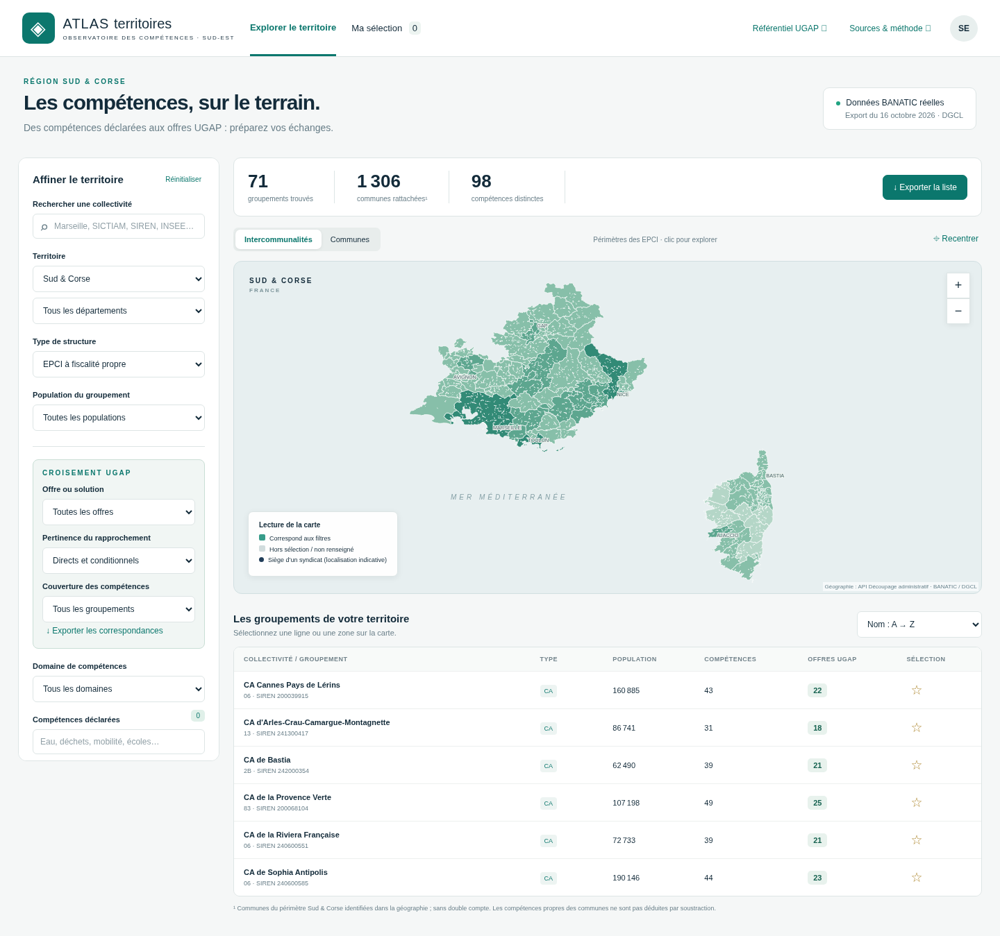
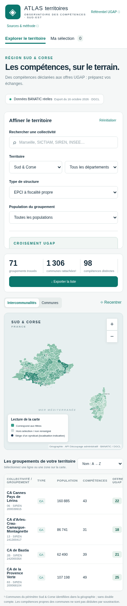

# Analyse de la carte BANATIC — Sud & Corse

Analyse du site [Atlas des compétences — Sud & Corse](https://banatic-sud-corse.marcdeturcan.chatgpt.site/) pour préparer la reconstruction de sa carte interactive.

[Lire le rapport technique](docs/analyse-banatic/rapport.md)

Les captures ci-dessous montrent les fichiers publics du site rendus localement. Les polices externes ont été remplacées par les polices de repli du site. Elles illustrent le site existant ; la reconstruction n’est pas encore implémentée dans ce dépôt.

## Version ordinateur

## Version mobile

